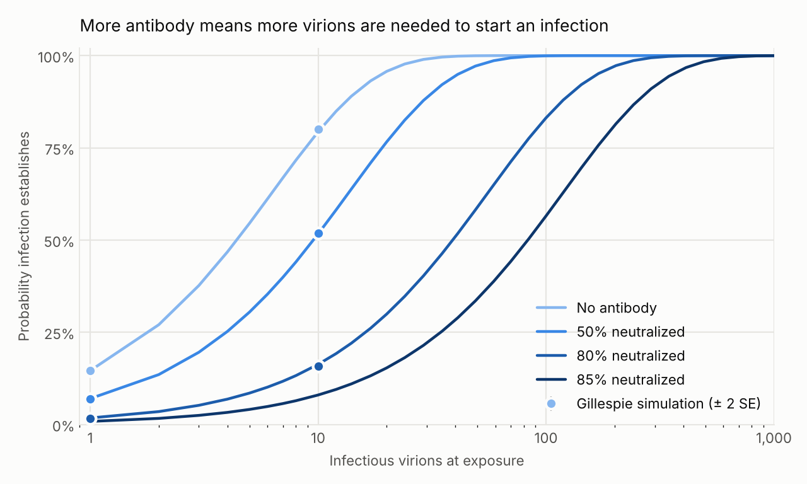
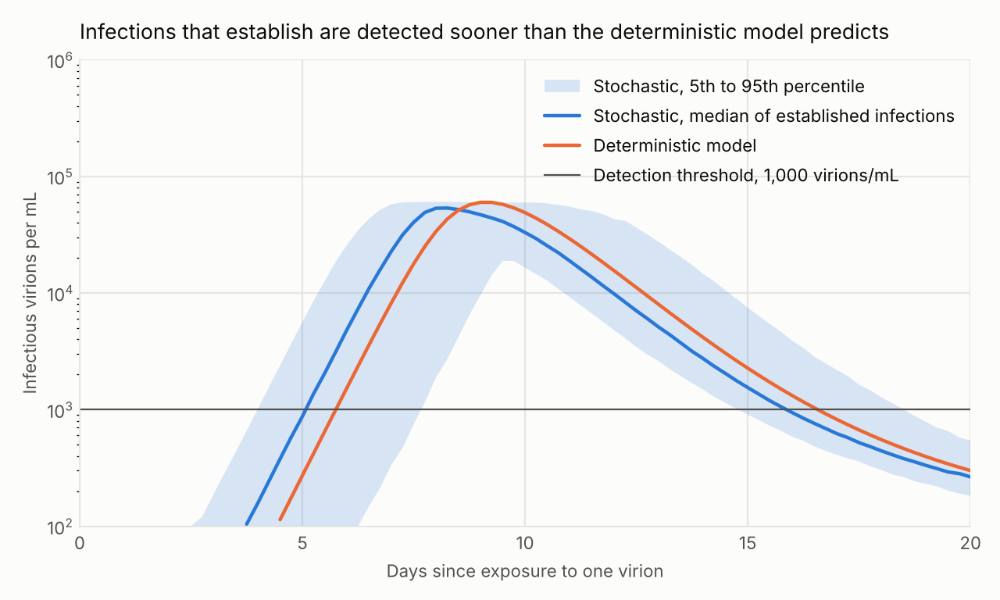

# Stochastic viral dynamics

[](https://github.com/jadmycrazy/stochastic-viral-dynamics/actions/workflows/tests.yml)

Why do most HIV exposures never become infections, and how much does a neutralizing antibody change the odds?

A deterministic within-host model says any virus with R0 > 1 always takes off. Infections start from a handful of virions, so the early phase is a matter of chance. This repo simulates the first days of HIV infection three ways:

- **Exact stochastic simulation** (Gillespie) while counts are small
- **Chemical Langevin equation**, a stochastic differential equation integrated with Euler-Maruyama, once the infection grows
- **Branching-process theory** for the exact establishment probability, used to check the simulations

The model tracks target cells, eclipse-phase and productive infected cells, and infectious virions, with standard HIV rates (clearance 23/day, infected-cell death 1/day, eclipse 1 day) and R0 = 8. Neutralizing antibody blocks a fixed fraction of infection events.

## Results

| | Value |
|---|---|
| Chance one virion establishes infection (R0 = 8) | 14.6% |
| Ten virions | 79% |
| Per-virion risk at 50 / 80 / 85% neutralization | 7.0% / 1.8% / 0.83% |
| Neutralization where R0 falls below 1 | 89.4% |
| Time to 1,000 infectious virions/mL, established infections (median, 5-95%) | 5.25 days (4.0-7.75) |
| Same, deterministic model | 6.0 days |

Gillespie estimates match the branching-process formula within two standard errors in all six checks (20,000 runs for one virion, 4,000 for ten).



Lines are the exact branching-process result. Points are Gillespie estimates.



The stochastic curves include only exposures that establish. Those are the lineages that grew fast early, so they reach the detection threshold before the deterministic model does.

## Install and run

```
pip install -e ".[dev]"
pytest
```

The package installs a command-line tool:

```
viral-dynamics theory --virions 10 --neutralization 0.5
viral-dynamics simulate --virions 1 --runs 5000 --seed 1
viral-dynamics experiments --out results/viral.json    # about 30 seconds
viral-dynamics figures --results results/viral.json --out docs/figures
```

`experiments` uses a fixed seed, so it reproduces `results/viral.json` exactly.

From Python:

```python
import numpy as np
from viral import establishment_probability, simulate_early_infection

establishment_probability(1)                      # 0.1458
rng = np.random.default_rng(0)
simulate_early_infection(1, rng).established      # True or False for one exposure
```

## Layout

| Path | Contents |
|---|---|
| `viral/parameters.py` | Rate constants and their sources |
| `viral/theory.py` | R0, extinction and establishment probability, critical neutralization |
| `viral/gillespie.py` | Exact simulator for the early phase |
| `viral/langevin.py` | Vectorized Euler-Maruyama integrator for the growth phase |
| `viral/deterministic.py` | Runge-Kutta solution of the mean-field equations |
| `viral/experiments.py` | Validation, dose and neutralization sweeps, hybrid trajectories |
| `viral/plotting.py` | Figures in this README |
| `viral/cli.py` | Command-line interface |
| `tests/` | Checks against exact results, run on every push by GitHub Actions |

## Limitations

- **Exposure starts at the target cells.** The model begins with infectious virions that have already reached target cells. Mucosal barriers and the low per-act transmission rate are not modeled, so 14.6% is a per-virion figure, not a per-exposure risk.
- **Well mixed, no space.** Early infection is local. Target-cell density near the founder cell matters and is not represented.
- **No immune response.** There is no innate or cellular response, so the model is only meaningful for the first weeks and the viral load after the peak should not be read as a set point.
- **Neutralization is one fixed number.** Real antibody concentration varies by tissue, wanes over time and differs in potency across strains. Antibody effects other than blocking entry, such as Fc-mediated killing of infected cells, are left out.
- **Memoryless lifetimes.** Infected cells die at a constant rate, which makes the number of virions released geometric. The establishment probability depends on that choice (Pearson, Krapivsky and Perelson 2011).
- **No cell-to-cell spread.** Only cell-free virus infects.
- **Langevin approximation.** It is accurate only when counts are large. The handoff from exact simulation happens at 200 particles, and clamping states at zero adds a small bias near extinction.
- **Parameters are literature values**, mostly estimated in chronic infection, and are not fitted to data here.

## References
Gillespie, *J Phys Chem* 1977 and *J Chem Phys* 2000; Pearson, Krapivsky and Perelson, *PLoS Comput Biol* 2011; Ribeiro et al., *J Virol* 2010; Ramratnam et al., *Lancet* 1999; Markowitz et al., *J Virol* 2003; Keele et al., *PNAS* 2008; Corey et al., *NEJM* 2021.
